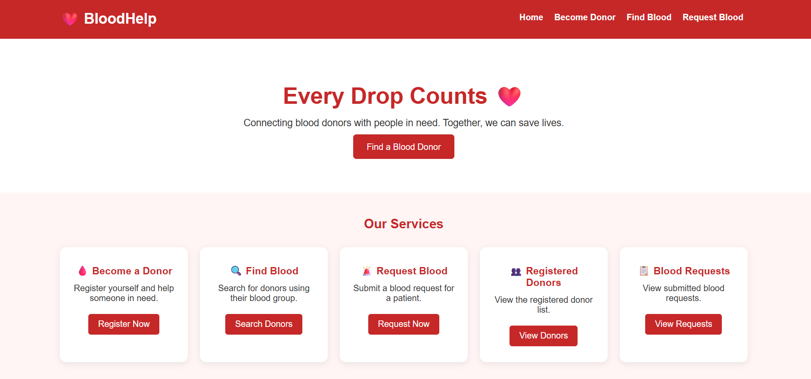
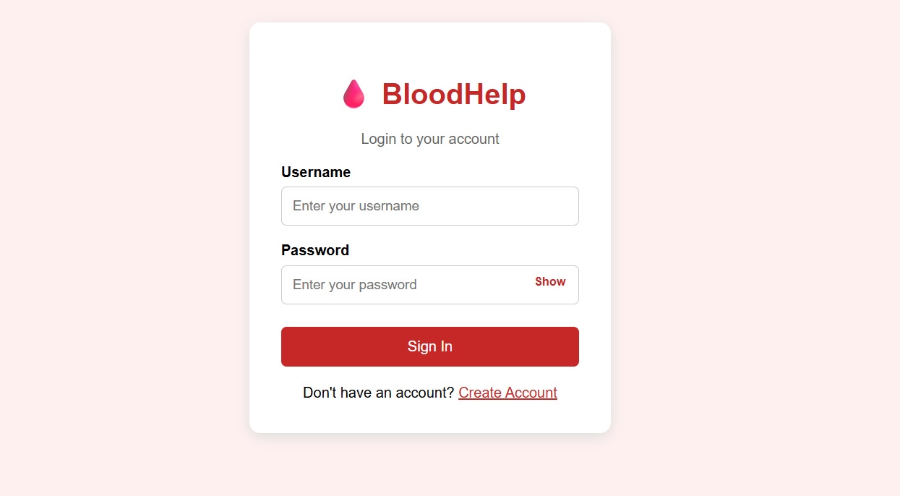
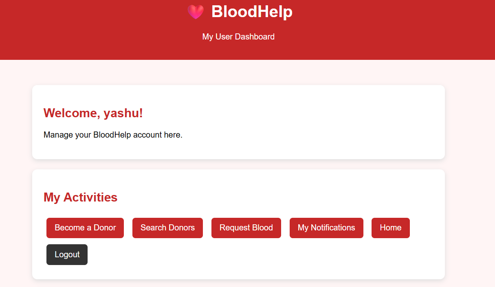
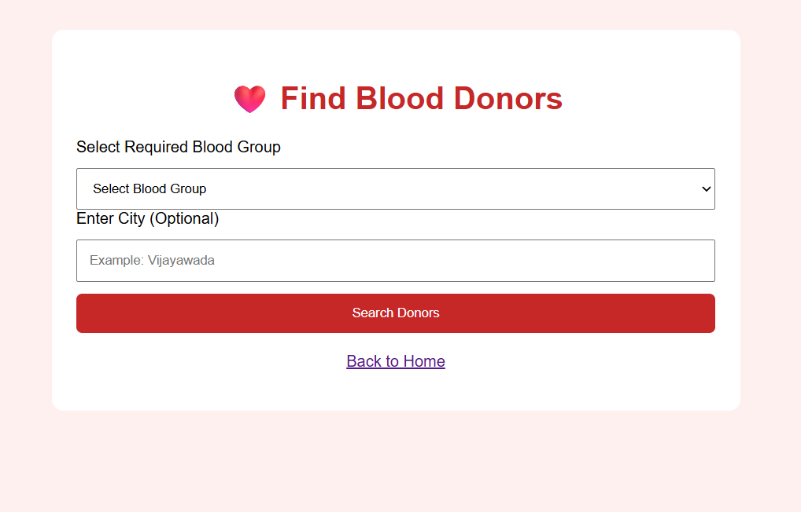

# 🩸 BloodHelp
### Connecting Blood Donors with People in Need

## 📌 About the Project

BloodHelp is a web-based blood donor management and emergency blood assistance platform developed using Java and Spring Boot.

The main purpose of this project is to help people find potential blood donors during medical emergencies. Users can register as donors, search for donors based on blood group and location, and access donor contact information.

## 🎯 Objectives

- Make finding blood donors easier.
- Connect blood donors with people who need blood.
- Reduce the time required to find potential donors during emergencies.
- Encourage voluntary blood donation.
- Provide a simple and user-friendly platform.

## ✨ Features

- User Registration and Login
- User Dashboard
- Become a Blood Donor
- Donor Information Management
- Search Donors by Blood Group
- Search Donors by Location
- Donor Verification
- Emergency Blood Assistance
- Donor Contact Options

*Only list features that are implemented and tested in your current version.*

## 🛠️ Technologies Used

| Technology | Purpose |
|---|---|
| Java | Backend Programming |
| Spring Boot | Backend Framework |
| Spring MVC | Web Request Handling |
| Spring Data JPA | Database Operations |
| Maven | Dependency Management |
| Thymeleaf | Dynamic Web Pages |
| HTML | Frontend Structure |
| CSS | Frontend Styling |
| JavaScript | Frontend Interactions |
| H2 Database | Database (if configured) |

## 📂 Project Structure

```text
BloodHelp/
│
├── src/
│   ├── main/
│   │   ├── java/
│   │   └── resources/
│   │       ├── static/
│   │       ├── templates/
│   │       └── application.properties
│   │
│   └── test/
│
├── .mvn/
├── mvnw
├── mvnw.cmd
├── pom.xml
├── .gitignore
└── README.md
```

## 💻 Requirements

Before running this project, install:

- Java JDK (version compatible with the project)
- Visual Studio Code or another Java IDE
- Git
- Internet connection for downloading Maven dependencies

## 🚀 How to Run the Project

Follow these steps to run BloodHelp on your laptop.

### Step 1: Clone the Repository

Open the terminal and execute:

```bash
git clone https://github.com/YOUR-USERNAME/BloodHelp.git
```

Replace YOUR-USERNAME with your GitHub username.

### Step 2: Open the Project

```bash
cd BloodHelp
```

Open the folder in VS Code:

```bash
code .
```

### Step 3: Configure the Database

Open:

```text
src/main/resources/application.properties
```

Configure the database according to the project settings.

For H2, use the existing H2 configuration.

For MySQL, install MySQL and configure the database URL, username, and password.

Do not upload private database credentials.

### Step 4: Run the Application

For Windows:

```bash
mvnw.cmd spring-boot:run
```

For Linux/macOS:

```bash
./mvnw spring-boot:run
```

Wait until the Spring Boot application starts successfully.

### Step 5: Open the Application

Open your browser and visit:

```text
http://localhost:8080
```

BloodHelp should now be running locally.

## 📸 Screenshots

Add screenshots of your actual application here.

```markdown







```

## 🔐 Security

- Do not upload passwords or secret keys.
- Do not expose real donor or patient information.
- Validate user information before storing it.
- Use secure authentication practices.

## 🔮 Future Enhancements

- Email and SMS notifications.
- Location-based donor search.
- Improved donor verification.
- Emergency request tracking.
- Mobile application integration.
- Cloud deployment.

## 👩‍💻 Project Information

**Project Name:** BloodHelp

**Project Type:** Web Application

**Domain:** Healthcare and Social Impact

**Backend:** Java and Spring Boot

**Frontend:** HTML, CSS, JavaScript and Thymeleaf

## 📄 License

This project is developed for educational purposes